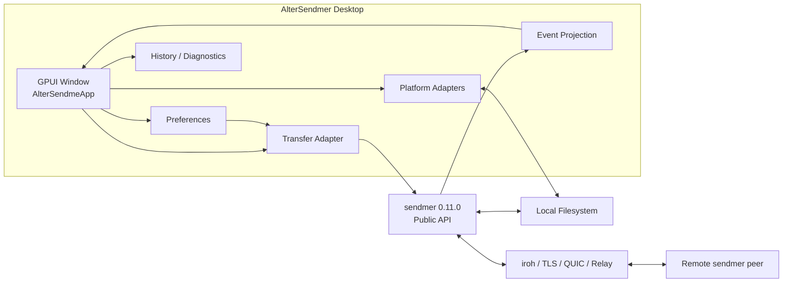

# AlterSendmer 主线设计与开发计划

本文是 AlterSendmer 唯一的主线设计与开发计划。它合并了原 GPUI 设计说明与阶段开发计划，
并与 `sendmer v0.11.0` 的公开契约对齐。旧 Tauri 客户端迁移说明继续独立保留，但不再承担
当前架构或未来计划。

## 1.1 2026-11-24 核心简化迁移边界

sendmer 核心仓库已完成职责拆分，公开主要入口为 `send_handle(path, options)` 和
`receive(ticket, options)`。事件、取消和资源上限入口保留一个兼容周期。核心模块现在负责
transport、transfer、manifest、recovery、filesystem 和 events 的职责。

本仓库当前继续使用 crates.io 的 `sendmer 0.11.0`。桌面端暂时保留现有适配调用，避免引用
尚未发布的核心 API。核心新版本发布后，`src/transfer.rs` 应切换到
`send_handle_with_events` 和 `receive_with_events_and_cancellation`，然后重新执行桌面测试和
真实窗口验收。桌面端继续负责 GPUI 状态、偏好、历史、本地化和更新界面，不读取核心缓存布局。

## 1. 术语表与命名约定

| 规范名称 | English / 缩写 | 职责边界 | 不代表什么 |
| --- | --- | --- | --- |
| 核心传输层 | sendmer Core | 负责 ticket、点对点传输、重试、限速、路径安全和资源清理 | 不负责 GPUI 状态、本地化或更新界面 |
| 桌面客户端 | AlterSendmer Desktop | 负责 GPUI 交互、配置、状态投影、历史和平台集成 | 不复制协议、缓存数据库或限速器 |
| 传输适配器 | Transfer Adapter | 将桌面配置、取消和事件映射到 sendmer 公开 API | 不是第二套传输实现 |
| 传输票据 | Ticket | 允许接收方连接并请求内容的 bearer capability | 不是账号、长期授权或云端分享链接 |
| 传输会话 | Transfer Session | 一次 send 或 receive 的应用层生命周期 | 不是单条 QUIC 连接或 UI 页面 |
| 事件信封 | Event Envelope | 承载 schema 版本、会话 ID、序号、阶段和事件载荷 | 不参与控制流，也不替代函数返回值 |
| 结构化错误 | Transfer Error | 提供稳定错误码、失败阶段、可重试属性和安全摘要 | 不是本地化文案或完整内部错误链 |
| 上传速率上限 | Upload Rate Limit | 一个 sender 对所有接收方共享的 payload 上限 | 不是每个 peer 的独立配额或精确 QoS |
| 持久接收缓存 | Persistent Receive Cache | 由 sendmer 保留已验证数据，供后续 receive 进程恢复 | 不是云存储、永久会话或跨设备同步 |

公开产品名统一为 `AlterSendmer`。内部 crate/进程名 `alter-sendmer`、安装标识
`top.likanug.alter-sendme` 和旧 `AlterSendme` 配置目录只为升级兼容保留，不出现在新的产品
名称、窗口标题或发行资产名称中。

## 2. 产品边界与当前基线

本版 `AlterSendmer v0.7.1` 使用 crates.io 的 `sendmer 0.11.0` 和 `gpui-kit 0.10.0`。
自 `v0.7.0` 起，桌面客户端通过 GPUI Kit 加载原生平台后端。
桌面客户端
提供不依赖账号、服务器或云端存储的原生点对点文件传输。传输票据是 bearer capability：
拿到有效票据即可接收，因此界面和文档必须提醒用户只通过可信渠道分享。

桌面客户端负责：

- 文件/目录选择、拖放、ticket 输入与剪贴板、保存位置和系统 reveal。
- 发送/接收状态、进度、取消、重试、历史、诊断、主题和 21 种语言。
- 将 relay、重试、上传上限和持久缓存偏好映射到 sendmer 公开选项。
- 原生安装包、签名更新清单和平台发布体验。

桌面客户端不负责：

- iroh/QUIC 协议、ticket 格式、路径校验、原子导出、缓存布局、锁或 prune 规则。
- 账号、云端文件存储、后台同步、多租户控制面或自建 relay 运维。
- 使用本地 path、Git revision 或提交哈希绕过 sendmer 正式版本发布顺序。

## 3. 总体架构与依赖方向



依赖只能从桌面客户端指向 sendmer 公开 API。事件从核心传输层投影回 UI，但控制流仍以
异步任务的返回值和取消句柄为准。桌面客户端不得读取 sendmer 私有临时目录、manifest、
FsStore、Router 或底层 connection/request ID。

## 4. 应用状态与并发模型

`AlterSendmeApp` 是唯一 UI 状态机，持有当前工作区、选择路径、ticket、偏好、历史、提示和主题。
异步任务只通过 `WeakEntity` 回到 GPUI 主线程；每次传输分配 generation，旧任务完成时不得覆盖
新会话状态。

发送状态：

```text
Idle -> Preparing -> Sharing -> Metadata -> Transporting -> Finalizing -> Completed
                         \-> Stopping -> Idle
                         \-> Failed -> Retry
```

接收状态：

```text
Idle -> Connecting -> Metadata -> Transporting -> Exporting -> Finalizing -> Completed
                 \-> Stopping -> Idle
                 \-> Failed -> Retry
```

- 发送端持有 opaque `SendHandle`，直到用户停止共享或应用退出；资源关闭顺序由 sendmer 保证。
- 接收端持有 cancellation sender；取消只发出优雅取消信号，等待核心任务完成清理后再重置 UI。
- 应用退出先停止 sender，再取消并等待 receiver，不能先删除核心正在使用的目录。
- completed、failed、cancelled 互斥；失败状态保留安全摘要和可重试属性，不展示内部错误链。

## 5. 传输适配器契约

### 5.1 配置映射

| 桌面偏好 | sendmer 映射 | UI 规则 |
| --- | --- | --- |
| Relay 模式 | `SendOptions` / `ReceiveOptions` relay 配置 | 使用明确选项，不展示底层地址结构 |
| 重试与分块 | `ReceiveRetryPolicy` | 无效值在启动任务前拒绝 |
| 上传上限 | `max_upload_rate_bytes_per_sec` | 输入 `1..10240 MiB/s`，checked multiplication 转为 bytes/s；不限速为 `None` |
| 持久缓存 | `ReceiveCacheOptions` | 默认启用；新条目 TTL 为 `1 / 7 / 30` 天，默认 7 天 |
| 清理过期缓存 | `prune_receive_cache` | 只报告 removed/retained/active/unknown，不宣称清空全部缓存 |

上传上限是一个 sender 对所有接收方共享的 payload 平均上限，不包含全部 QUIC、Bao 或 relay
开销。桌面客户端不实现第二套 limiter，也不将它描述为精确线路 QoS。

持久缓存目录由桌面客户端在系统 cache 根下派生并传给 sendmer；桌面客户端不解析其中数据。
失败或取消保留已验证范围，成功导出删除对应条目。TTL 变更只影响之后创建的新条目；prune
保留活动、未过期、损坏和未来 schema 条目。

### 5.2 事件与错误映射

传输适配器实现 `sendmer::EventEmitter`，经无锁 channel 把事件交给 UI。消费者先过滤旧 generation，
再使用上游 `TransferEventStreamValidator` 校验 schema、session、role、sequence、文件名和终态。
首次违反契约后保持拒绝，直到用户显式启动新传输并重置验证器；验证通过后才投影 UI。

- `started`、`progress` 和 `file_names` 是非终态。
- `completed`、`failed`、`cancelled` 是唯一终态。
- 未知 schema、重复序号或序号缺口进入安全失败状态，不猜测事件含义。
- `TransferError.code` 驱动本地化摘要，`phase` 驱动失败位置，`retryable` 决定是否提供重试。
- 日志和历史不得持久化完整 ticket、绝对路径、节点密钥或底层连接标识。

历史保存在应用数据目录的 `history.json`，只包含角色、展示路径、大小、耗时、平均速度、时间、
结果，以及可选 session ID、错误码和阶段；新增字段保持旧文件反序列化兼容。

## 6. 交互与视觉规范

- 默认窗口 `1024x720`，最小 `760x560`；内容区滚动，固定控件不得因状态或翻译改变布局尺寸。
- 发送/接收是唯一的主任务分段导航；历史、传输设置和诊断是低强调次级工具。
- 接收空闲态固定为三步：`1` 传输票据、`2` 保存位置、`3` 开始接收。
- 票据输入使用 GPUI 原生文本输入，支持输入法、选择、键盘粘贴和长文本；粘贴与浏览是次级动作。
- 接收主按钮是唯一宽主按钮：无票据时禁用，失败时原位变为重试，传输中变为停止。
- 帮助内容只在展开后出现，不与接收按钮竞争，也不复制票据输入提示。
- relay、重试、下载分块、上传上限和持久缓存集中在传输设置；二元值用开关，枚举用选项控件，
  数值使用稳定宽度输入。
- 主题和语言使用紧凑控件；语言浮层在最上层并独立滚动，21 个 locale 均有核心导航与设置文案。
- 任何传输进行中都禁用会改变资源语义的选择、tab 切换和配置动作。

界面验收至少覆盖 `1024x720` 与 `760x560` 的发送、接收和设置页，以及语言浮层。长票据、
禁用态、失败重试、长翻译和帮助展开需有可重复检查，不能只凭编译通过宣称视觉完成。

## 7. 平台、更新与发布

| 平台 | 发布资产 |
| --- | --- |
| Windows x64、ARM64 | NSIS 安装器、便携 ZIP。自动更新使用 NSIS 安装器 |
| Linux amd64、ARM64 | AppImage、DEB。自动更新使用 AppImage |
| macOS Apple Silicon、Intel | DMG、应用更新归档 |

更新归档由 cargo-packager 使用同一 minisign 信任链签名；`latest.json` 按 `OS-ARCH` 映射下载
地址、签名和安装格式。客户端只在签名验证通过后进入安装路径；启动时静默检查，用户主动检查
时才展示最新状态或错误。

CI 在 Windows、Ubuntu 和 macOS 执行 fmt、check、Clippy 和 tests。Release 在六个原生执行器
上构建，核对安装包中的二进制架构。汇总作业使用应用内置公钥验证更新签名，并验证最终校验和。
每个发布批次同时上传包、
`SHA256SUMS`、SPDX SBOM、Sigstore bundle 和 GitHub provenance attestation；签名与证明校验
失败时停止发布。Release 正文由 tag 提交范围生成，重跑同一 tag 时幂等更新。

## 8. 已完成阶段与版本矩阵

| 桌面版本 | sendmer 版本 | 已完成范围 |
| --- | --- | --- |
| `v0.3.0` | `0.7.0` | opaque `SendHandle`、上传速率配置、接收页初次层级收敛 |
| `v0.4.0` | `0.8.0` | 版本化事件、结构化错误、历史诊断字段和三平台发布 |
| `v0.5.0` | `0.9.0` | 三步接收工作流、持久接收缓存开关/TTL/prune、完整本地化与视觉验收 |
| `v0.6.0` | `0.10.0` | 会话生命周期、接收方上限、TM1 选择、跨进程兼容回归和 Windows 原生截图验收 |
| `v0.7.0` | `0.11.0` | 诊断报告导出、票据与焦点修复、传输事件流校验、GPUI Kit 依赖迁移 |
| `v0.7.1` | `0.11.0` | 修复 macOS 应用图标 |
| `v0.7.3` | `0.11.0` | 六平台原生打包、macOS Intel、Windows ARM64、Linux ARM64、完整应用包签名和统一二进制名 |

`v0.6.0` 只消费 sendmer 已发布能力，不引入账号、云存储、后台同步、
内核级网络故障注入或跨设备永久续传。

## 9. 下一主线与跨项目协调

下一桌面版本不预先承诺新的核心协议。工作按以下顺序进入：

### A10.1 独立桌面质量改进

- 完善长票据、失败重试、帮助展开、最小窗口和高 DPI 的自动截图入口。
- 增强键盘焦点、AccessKit 标签、诊断导出和更新失败恢复，不扩大日志隐私范围。
- 为偏好迁移、历史兼容、缓存映射和退出清理持续补回归。

`v0.7.0` 收录已完成的桌面改进。2026-08-26 已完成诊断导出子项：诊断面板可将仅含支持安全字段的
摘要保存为带时间戳的文本文件；报告固定包含角色、阶段、错误码、错误阶段、序号、耗时和
安全摘要，使用不覆盖写入，保存成功和权限失败均有本地化状态提示，并已补充文件名、内容
脱敏、稳定阶段值和重复写入保护测试。2026-08-27 已完成长票据输入边界子项：剪贴板和键盘
替换均限制为 16,384 字节，超限时保留原值并显示本地化提示，窄窗口文本不会撑破输入框；
2026-08-27 已修正票据和上传上限输入的 GPUI 焦点绑定，并扩展 Windows 截图脚本；2026-08-31
已在 Windows 真实窗口运行 `scripts/capture-ui-acceptance.ps1`，输出覆盖默认/最小窗口、语言
下拉、票据键盘焦点、格式错误后的失败与重试、帮助展开和超长票据提示的截图与操作日志。真实
网络失败重试、高 DPI、更新失败恢复和完整 Windows 原生截图验收仍未完成。2026-09-02 已补齐
发送/接收 tab 的 `aria-selected` 与语言选项容器的 `ListBox` 语义，并由同一脚本通过 Windows
UI Automation 校验选中状态；AccessKit 语义子项完成，但不代表完整辅助技术验收完成。

### A10.2 已完成：接入 sendmer v0.11.0

`AlterSendmer v0.7.0` 使用 sendmer 提供的事件流校验器。

- 界面更新前，校验器检查会话、角色、序号和事件状态。
- 校验失败后，桌面端停止接收该次传输的后续事件。开始新传输时重建校验状态。
- 跨进程测试覆盖常规文件和 TM1 目录传输。

### A10.3 第二产品方向

后台 daemon、跨设备同步、账号、云端文件托管和多租户控制面需要独立产品设计、认证、持久
状态、冲突解决和运维方案。它们不进入 AlterSendmer 一次性传输主线，也不能由 GUI 私自扩展
sendmer ticket 语义。

### A10.4 参考 LocalSend 与 croc 的后续路线

LocalSend 的官方协议使用局域网发现、设备指纹、HTTPS REST 接口、准备阶段会话和文件级 token。
它支持文件、目录和文本，并提供桌面、移动、Web 和 headless 入口。croc 采用短口令 PAKE、
直连与 relay fallback、代理、IPv6 优先、断点恢复和按块校验。两者的交互方式和协议边界不同，
AlterSendmer 只借鉴可验证的产品能力，不把 LocalSend REST 混入 sendmer Core，也不复制 croc 的
内部传输实现。[LocalSend 协议 v2.2](https://github.com/localsend/protocol/blob/main/README.md)
。[croc README](https://github.com/schollz/croc/blob/main/README.md)。

#### P0 桌面质量和代码结构

已完成 `d553615` 的状态、持久化、输入、渲染和测试拆分，以及 `e46b9d9`、`87091d4` 的 Windows 选择器、
系统目录打开和进度信息修复。后续只保留真实 Windows 窗口验收、路径异常处理和高 DPI 检查。

- 保持 `app.rs` 只负责 `AlterSendmeApp` 状态机和 sendmer 事件生命周期。模型、持久化、输入、
  渲染和测试分别放在独立模块。
- 在 Windows 真实窗口验收文件选择、文件夹选择、接收目录打开、字节进度、速度和高 DPI。
- 为路径不存在、权限不足、非 ASCII 路径、网络盘和被占用的目标目录显示稳定错误摘要。
- 继续保留 macOS、Windows、Linux 的编译、格式和 Clippy 检查。发布工作流继续使用六个原生
  执行器生成目标安装包。

验收条件是三平台检查通过、Windows 真实窗口完成发送和接收闭环，并且拆分前后的 42 项测试全部
通过。回退范围是恢复 `app.rs` 和对应的 `mod` 声明，不改变 sendmer 接口。

#### P1 可恢复传输和文件一致性

- 为每个文件建立稳定的 manifest，记录相对路径、大小、修改时间、完整 SHA-256 和 chunk 大小。
- 为每个接收会话保存已确认的 chunk 范围或位图。重连后只请求缺失范围，重复请求必须幂等。
- 完成后先验证每个文件和整个目录的摘要，再原子提交到目标路径。校验失败时保留可诊断的临时状态。
- 显示恢复次数、已确认字节、剩余字节、速度、预计剩余时间和当前连接路径。
- 继续使用 sendmer 的持久接收缓存，不让桌面端读取其私有缓存结构。补充断网、切换网络、
  relay 降级和应用重启后的恢复测试。

验收条件是 150 ms 往返延迟、抖动、限速、丢包和短时断网组合场景下能够续传，最终 SHA-256
一致，恢复耗时可记录。重连测试参考 croc 的 bundle reconnect 测试和按块校验流程。
[croc bundle reconnect test](https://github.com/schollz/croc/blob/main/src/croc/bundle_test.go)。

当前实现切片已增加 `recovery.json`、manifest 摘要、chunk size/count、已验证字节、恢复次数和
恢复状态展示。核心分块校验与缺失范围恢复继续由 sendmer 0.11.0 负责。弱网脚本和运行字段见
`scripts/weaknet-baseline.sh` 与 `docs/weak-network-acceptance.md`。

#### P2 局域网发现和连接选择

- 新增独立 `Discovery Adapter`，提供设备别名、设备类型、系统、端口、协议版本和指纹。
- 首选受控的 UDP multicast 发现。multicast 不可用时，允许同网段 register fallback 和手工
  地址输入。发现数据只用于候选连接，不能直接授予下载权限。
- 增加网络切换后的重新发现、连接路径显示、IPv4/IPv6 回退和 relay 健康缓存。
- 保留现有 ticket 连接入口，发现功能采用可选模式，便于 headless 和跨网 relay 使用。

LocalSend 的协议使用 `224.0.0.167:53317`、HTTP register fallback、设备指纹和 `prepare-upload`
会话。AlterSendmer 应重新定义适配层字段和认证边界，避免把未经认证的发现包当作信任记录。
[LocalSend README](https://github.com/localsend/localsend/blob/main/README.md)。

#### P3 安全和授权模型

- 为设备增加长期公钥或证书指纹。首次连接显示确认信息，后续连接检测指纹变化。
- 为 ticket 增加可选有效期、下载次数、撤销状态和会话范围。分享票据和一次下载会话分别认证。
- 评估短 PIN 或二维码作为 PAKE 输入。密钥派生必须绑定会话、双方身份和协议版本。
- 对发现消息、路径规范化、文件名渲染、超长消息、压缩炸弹和临时文件清理建立独立安全回归。
- 日志继续排除 ticket、密钥、绝对路径和文件内容。relay 只记录必要的连接摘要和资源计数。

LocalSend 的公开安全记录包含未经认证的 UDP 发现、路径遍历和文件名显示风险。AlterSendmer
在启用发现和跨网连接前，必须完成威胁模型、协议字段审查和真实平台回归。
[LocalSend Security Advisories](https://github.com/localsend/localsend/security)。

#### P4 文件和用户体验

- 支持多文件、混合目录、空目录策略、目录根保留和跨平台路径显示。
- 增加目标冲突策略，包括覆盖、自动改名、跳过和逐项确认，并在完成摘要中列出结果。
- 增加发送前摘要、文件数量、总大小、预估时间和校验状态。接收端显示保存路径和可用磁盘空间。
- 支持 QR 展示和扫描、文本发送、剪贴板发送，以及复制 ticket 与设备信息的统一入口。
- 为取消、暂停、恢复、失败重试和网络切换显示明确状态。按钮状态必须与真实会话状态一致。

LocalSend 的 CLI 已覆盖文件、目录和混合输入。croc 还提供多文件、目录、文本、QR 和浏览器
入口。AlterSendmer 先完成桌面闭环，再决定哪些入口进入移动端和 headless 客户端。

#### P5 headless、移动端和生态接入

- 提供 `alter-sendmer-cli`，复用同一 transfer adapter、ticket、manifest 和更新签名格式。
- 增加无窗口发送/接收、标准输入输出、退出码、JSON 事件和脚本化路径冲突策略。
- Android 和 iOS 作为独立适配项目，先复用协议与 sendmer 能力，再分别处理后台传输、文件权限、
  分享菜单、二维码和系统通知。
- Web 接收和异步云端存储暂不进入桌面主线。若未来增加，必须设计端到端加密、有效期、撤销、
  下载次数、分块校验和服务端资源清理。

#### P6 发布和运维

- 继续用六个原生执行器生成 Windows x64/ARM64、Linux amd64/ARM64、macOS ARM64/Intel。
- 发布前核对应用内部二进制名、安装器名、更新清单、minisign、Sigstore、SBOM、provenance
  和 SHA-256 是否指向同一批文件。
- 为 relay 增加首帧超时、握手期限、每源并发上限、消息大小限制、磁盘配额和临时文件回收。
- 记录直连、relay、代理、IPv4/IPv6 和恢复耗时的匿名统计，支持问题定位，不记录内容和票据。

## 9.5 版本安排与进入条件

| 版本 | 重点 | 进入条件 |
| --- | --- | --- |
| `v0.8.x` | P0 重构收尾、P1 manifest、分块恢复、冲突策略和 Windows 实窗验收 | 跨平台构建通过，弱网恢复和最终摘要测试通过 |
| `v0.9.x` | P2 局域网发现、手工地址、网络变化恢复和连接路径诊断 | 发现认证边界冻结，局域网和 relay 回退测试通过 |
| `v0.10.x` | P3 设备指纹、短 PIN/二维码、ticket 有效期和撤销 | 威胁模型、安全回归和密钥迁移方案通过审查 |
| `v0.11.x` | P4 多文件、冲突策略、文本和 QR 工作流 | Windows、macOS、Linux 真实窗口验收通过 |
| `v1.0.x` | P5 CLI、移动端适配计划和发布稳定性 | 协议兼容矩阵、升级回滚和长期传输测试通过 |

每个版本只进入一个主阶段。跨阶段功能必须先补接口约定、状态迁移、错误码、日志字段和回退
边界，再进入实现。sendmer Core 的新能力仍按独立版本发布，AlterSendmer 在 crates.io 可解析
后再升级依赖。

## 10. 质量门禁与发布顺序

每个独立功能提交前至少执行：

```text
cargo fmt --all -- --check
cargo check --workspace --all-targets --locked
cargo clippy --workspace --all-targets --all-features --locked -- -D warnings
cargo test --workspace --all-features --locked
```

受影响界面必须增加 Windows 默认/最小窗口截图验收；打包变更还需运行 portable 与相应原生
packager rehearsal。版本 tag 只能指向全部门禁通过的提交。

跨项目发布顺序固定为：

1. sendmer 完成功能、契约、测试、文档和版本提交。
2. sendmer 发布 crate 与 GitHub Release，并确认 crates.io 可解析。
3. AlterSendmer 使用正式版本号升级，完成适配、contract tests、三平台 CI 和视觉验收。
4. 发布 AlterSendmer；不得使用本地 path 或 Git revision 绕过顺序。

## 11. 文档维护规则

- 本文件是 AlterSendmer 架构、UI 规范、版本矩阵和未来计划的唯一主线来源。
- README 只保留用户能力、安装、开发入口和公开边界；`MIGRATION.md` 只记录旧 Tauri 客户端迁移。
- 每次 sendmer 或 AlterSendmer 发布后同步更新第 2、8、9 节，并核对 sendmer 依赖版本。
- 不再新增按单个功能拆分的长期设计文档；复杂功能先在本文件中冻结边界，再在代码/PR 中记录
  实施细节，避免形成多个互相漂移的“当前计划”。
